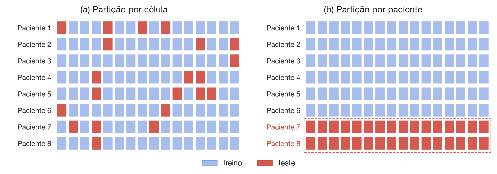
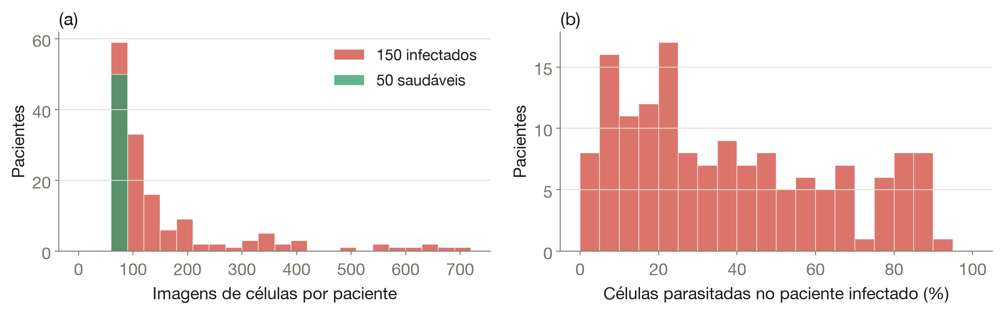
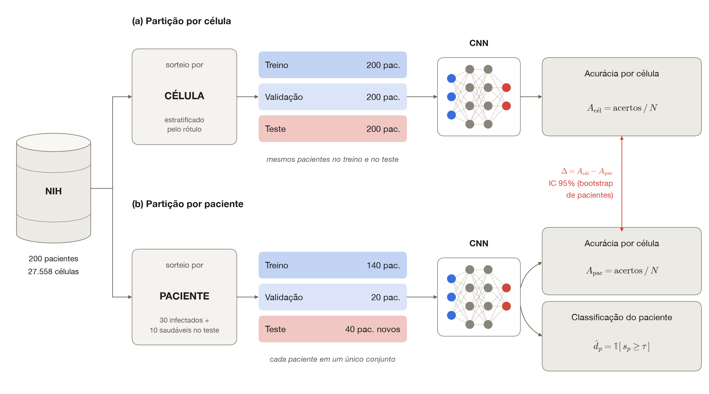
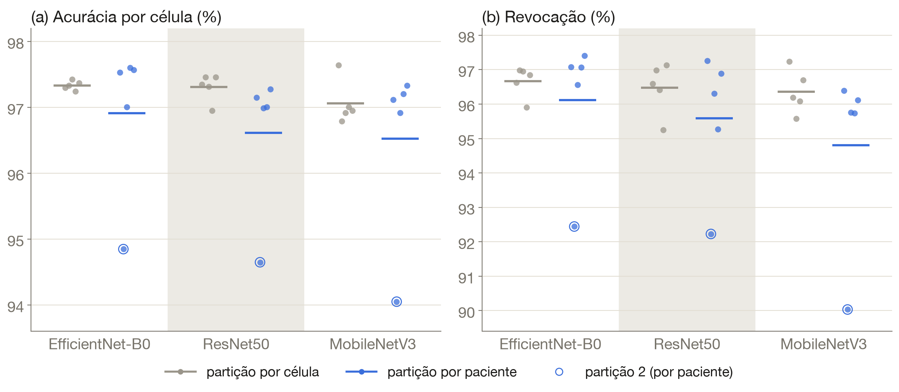
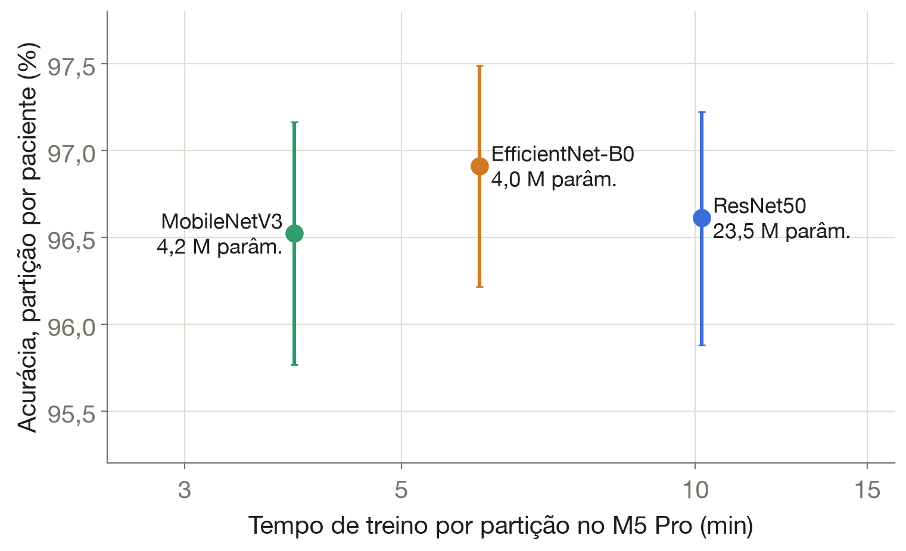
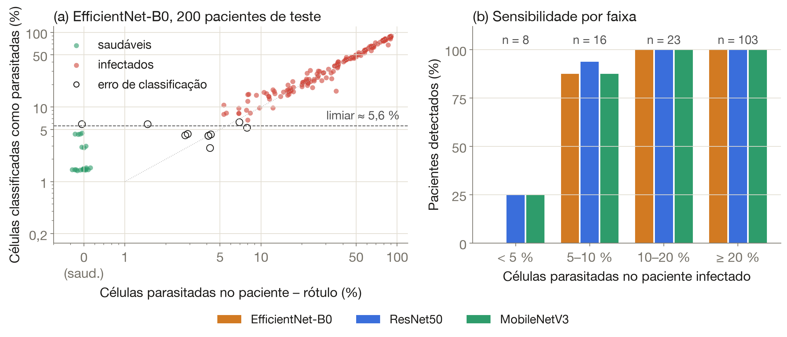
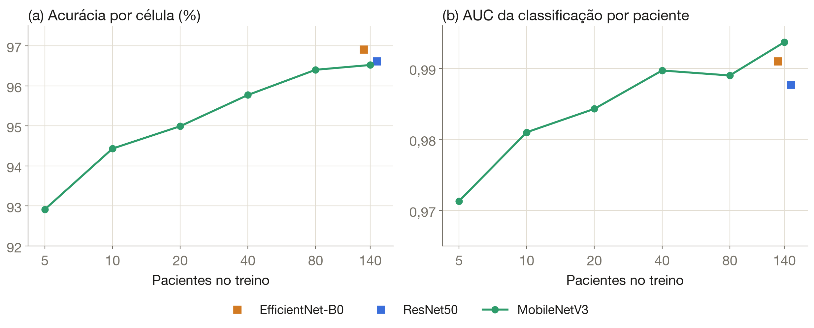

<!--
  Cópia para o site de Orientações da apresentação do artigo do V Simpósio NDAE (09/11/2026).
  Fonte: ~/GitRTx/SimposioNDAE/Artigo2B-Raphael-Pacientes/apresentacao/resultados.qmd (editar lá e copiar para cá).
  Trabalho NOVO, posterior à dissertação de Raphael Saraiva de Sousa (PPCA, 2026); em revisão pelos autores.
-->

# O que foi feito

- A pergunta
- O fluxo da avaliação
- As redes

## A pergunta

:::: {.columns}
::: {.column width="55%"}

:::
::: {.column width="45%"}
- A base NIH tem **27.558 células** de **200 pacientes** (150 infectados, 50 saudáveis)
- Quase toda a literatura, inclusive trabalhos anteriores do grupo, **sorteia células**: os pacientes do teste também estão no treino
- No uso real, o modelo encontra sempre um **paciente novo**, e a decisão é sobre o **paciente**

::: {.callout-question}
Quanto do desempenho sobra em pacientes **nunca vistos**?
:::
:::
::::

## Os dados por paciente {.nostretch}

{fig-align="center" width="1400px"}

- **Infectados:** 161 células em média (68 a 702), com mediana de **33 %** de parasitadas (de 1,4 % a 90 %)
- **Saudáveis:** 68 células em média, todas não parasitadas

## Fluxo da avaliação {.nostretch}

{fig-align="center" width="1500px"}

::: {.muted .smaller .center}
Mesmo tamanho de teste (~5.512 imagens) e 5 partições nos dois protocolos: muda só a **unidade sorteada**. Incerteza: IC 95 % por ***bootstrap* de pacientes** (2.000 reamostragens).
:::

## Três redes convolucionais

:::: {.columns}
::: {.column width="50%"}
::: {.callout-note title="Pré-treinadas no ImageNet, ajuste fino completo"}
- **EfficientNet-B0** (4,0 M de parâmetros)
- **ResNet50** (23,5 M)
- **MobileNetV3-Large** (4,2 M, feita para celulares)
:::
:::
::: {.column width="50%"}
::: {.callout-insight title="Treinamento"}
- Imagens de **128 px** (as células têm ~130 px)
- AdamW, lotes de 64, **10 épocas**
- Modelo final: época de menor perda na **validação**
:::
:::
::::

::: {.takeaway .fragment}
[55]{.num}
[execuções, em ~4 h de GPU no MacBook M5 Pro]{.label}
:::

# R1 · Célula × paciente

- O vazamento
- O que ele esconde

## A partição por célula superestima, pouco mas sempre

| Rede | Por célula | Por paciente | Δ acurácia (IC 95 %) | Δ revocação (IC 95 %) |
|:--|:-:|:-:|:-:|:-:|
| EfficientNet-B0 | 97,3 ± 0,1 | [96,9 ± 1,2]{.hl} | 0,42 (0,04 a 0,97) | 0,56 (−0,18 a 1,62) |
| ResNet50 | 97,3 ± 0,2 | 96,6 ± 1,1 | [0,69 (0,31 a 1,20)]{.hl} | 0,89 (0,13 a 1,93) |
| MobileNetV3 | 97,1 ± 0,3 | 96,5 ± 1,4 | 0,54 (0,16 a 1,03) | [1,56 (0,84 a 2,54)]{.hl} |

: Acurácia por célula (%, média ± desvio entre partições); Δ = célula − paciente, em p.p. {tbl-colwidths="[20,16,16,24,24]"}

:::: {.columns}
::: {.column width="50%"}
::: {.callout-note title="Todas perdem"}
As três redes perdem **0,4 a 0,7 p.p.** de acurácia em pacientes novos, com o IC 95 % **acima de zero** em todas.
:::
:::
::: {.column width="50%"}
::: {.callout-important title="A revocação é a mais inflada"}
Na MobileNetV3, **−1,6 p.p.** de revocação: o vazamento infla sobretudo a detecção das células parasitadas.
:::
:::
::::

## O que a partição por célula esconde {.nostretch}

{fig-align="center" width="1450px"}

::: {.takeaway .fragment}
[4 a 17×]{.num}
[maior é o desvio entre partições quando se separa por paciente (0,1–0,3 → 1,1–1,4 p.p.). A **partição 2** é a pior para as três redes.]{.label}
:::

## O vazamento se concentra em poucos pacientes

:::: {.columns}
::: {.column width="55%"}
| Paciente | Partição | Células | Parasitadas | Acurácia média |
|:--|:-:|:-:|:-:|:-:|
| C49P10 | 2 | 104 | 36 % | **80 %** |
| C116P77 | 2 | 482 | 86 % | **82 %** |
| C50P11 | 1 | 100 | 33 % | 87 % |
| C38P3 | 1 | 75 | 8 % | 88 % |
| C102P63 | 3 | 103 | 34 % | 88 % |

: Os 5 pacientes com menor acurácia por célula (média das 3 redes, partição por paciente) {tbl-colwidths="[22,14,16,22,26]"}
:::
::: {.column width="45%"}
- **C116P77:** de **93–96 %** (paciente também no treino) para **81–82 %** (paciente novo)
- Sem a partição 2, a diferença média cai para **0,1–0,5 p.p.**
- A dificuldade é **do paciente**: Spearman da acurácia por paciente **entre redes** de 0,76 a 0,82
- Células não parasitadas de infectados geram **2×** mais falsos positivos (2,0–2,7 %) que as de saudáveis (0,9–1,7 %)
:::
::::

## Qual rede é melhor em pacientes novos?

:::: {.columns}
::: {.column width="52%"}

:::
::: {.column width="48%"}
| Comparação | Diferença (IC 95 %) |
|:--|:-:|
| B0 − ResNet50 | **0,30** (0,10 a 0,50) |
| B0 − MobileNetV3 | **0,39** (0,18 a 0,59) |
| ResNet50 − MobileNetV3 | 0,09 (−0,15 a 0,32) |

: Acurácia por paciente, p.p.; *bootstrap* pareado de pacientes {tbl-colwidths="[55,45]"}

- A **EfficientNet-B0** vence, mas por **< 0,5 p.p.**
- **ResNet50 e MobileNetV3 empatam**, e a MobileNetV3 tem **1/6** dos parâmetros
:::
::::

# R2 · Classificação do paciente

- A regra
- Desempenho
- Onde estão os erros

## Da célula ao paciente, em duas etapas

:::: {.columns}
::: {.column width="50%"}
1. **Célula:** a rede dá uma probabilidade; a célula é **parasitada** se ela for ≥ 0,5
2. **Paciente:** fração de células parasitadas
$$s_p = \frac{\text{células parasitadas}}{N_p}$$
o paciente é **infectado** se $s_p \geq \tau$

::: {.callout-note title="Como se escolhe τ"}
Só com os **20 pacientes de validação**: o valor que acerta mais infectados **e** saudáveis ao mesmo tempo (índice de Youden), no **meio** da faixa que os separa.
:::
:::
::: {.column width="50%"}
| Paciente | Rótulo | Células | $s_p$ | Classe |
|:--|:-:|:-:|:-:|:-:|
| C137P98 | inf. | 408 | 80,6 % | inf. |
| C185P146 | inf. | 81 | 16,0 % | inf. |
| C151P112 | inf. | 73 | [8,2 %]{.hl} | inf. |
| C53P14 | inf. | 71 | [2,8 %]{.hl} | **saud. ✗** |
| C222 | saud. | 69 | [4,3 %]{.hl} | saud. |
| C213 | saud. | 69 | 0,0 % | saud. |

: Partição 1, EfficientNet-B0, τ = 6,1 % {tbl-colwidths="[24,16,16,20,24]"}

- τ **não pode ser zero**: a rede marca algumas células de saudáveis (C222: 4,3 %)
:::
::::

## Desempenho na classificação do paciente

:::: {.columns}
::: {.column width="45%"}
| Rede | AUC | Sens. (%) | Espec. (%) |
|:--|:-:|:-:|:-:|
| EfficientNet-B0 | [0,991]{.hl} | 93,3 | 98 |
| ResNet50 | 0,986 | [95,3]{.hl} | 96 |
| MobileNetV3 | [0,991]{.hl} | 94,7 | 98 |

: 200 pacientes (150 + 50); limiar da validação ≈ 5–6 % de células positivas {tbl-colwidths="[38,18,22,22]"}
:::
::: {.column width="55%"}
- Cada rede perde **7 a 10** dos 150 infectados e aponta **1 ou 2** dos 50 saudáveis
- **AUC 0,99:** em 99 % dos pares (infectado, saudável), o infectado tem $s_p$ maior
- A fração prevista **acompanha a real**: Spearman 0,985–0,989, erro médio de 2,2–2,5 p.p.

::: {.callout-insight}
O classificador de células já dá uma **estimativa da carga parasitária** do paciente, sem treino adicional.
:::
:::
::::

## Os erros estão nas poucas células parasitadas {.nostretch}

{fig-align="center" width="1450px"}

## Onde as redes erram

:::: {.columns}
::: {.column width="48%"}
| Células parasitadas | Pacientes | Detectados |
|:--|:-:|:-:|
| < 5 % | 8 | 0–25 % |
| 5–10 % | 16 | 88–94 % |
| 10–20 % | 23 | [**100 %**]{.hl} |
| ≥ 20 % | 103 | [**100 %**]{.hl} |

: Sensibilidade por faixa, nas 3 redes {tbl-colwidths="[36,24,40]"}
:::
::: {.column width="52%"}
- Os **12 infectados** perdidos por alguma rede têm no máximo **8 %** de células parasitadas (mediana de 4,2 %)
- **4** deles, todos abaixo de 5 %, não são detectados por **nenhuma** rede
- Com ~2 % de falsos positivos por célula, **70 células** não bastam para separar esse paciente de um saudável

::: {.callout-important title="Consequência prática"}
O ganho não virá de outra rede, e sim de analisar **mais células por paciente** (mais campos da lâmina) ou de **encaminhar** os casos limítrofes ao microscopista.
:::
:::
::::

# R3 · Quantos pacientes bastam?

- Curva de aprendizado
- Leitura para uma base local

## Curva de aprendizado em número de pacientes

{fig-align="center" width="88%"}

| Pacientes no treino | 5 | 10 | 20 | 40 | 80 | 140 |
|:--|:-:|:-:|:-:|:-:|:-:|:-:|
| Imagens | 587 | 1.190 | 2.208 | 5.294 | 11.379 | 19.238 |
| Acurácia por célula (%) | 92,9 | 94,4 | 95,0 | [95,8]{.hl} | 96,4 | 96,5 |
| AUC por paciente | 0,971 | 0,981 | 0,984 | [0,990]{.hl} | 0,989 | 0,994 |

: MobileNetV3; teste sempre com 40 pacientes não vistos {tbl-colwidths="[28,12,12,12,12,12,12]"}

## Leitura para uma base local (Pará, *P. vivax*)

::: {.panels}
::: {.panel}
**5 pacientes**

~590 imagens: 93 % por célula e AUC por paciente de **0,97**
:::
::: {.panel}
**40 pacientes**

a menos de **1 p.p.** do resultado com 140
:::
::: {.panel}
**Rede leve**

a **MobileNetV3** treina em **4 min** por partição e classifica uma célula em **0,2 ms**
:::
:::

::: {.takeaway .fragment}
[~40]{.num}
[pacientes rotulados (e avaliados por paciente) são um ponto de partida realista para uma base amazônica]{.label}
:::

# R4 · Custo computacional

- Tempos medidos
- Verificações

## Tempos registrados

:::: {.columns}
::: {.column width="58%"}
| Rede | Treino (min/partição) | Inferência (ms/img) |
|:--|:-:|:-:|
| MobileNetV3 | 3,9 | 0,22 |
| EfficientNet-B0 | 6,0 | 0,36 |
| ResNet50 | 10,1 | 0,67 |

: Apple M5 Pro (GPU de 16 núcleos); 128 px, lote 64, 10 épocas {tbl-colwidths="[40,32,28]"}
:::
::: {.column width="42%"}
| Rodada | Execuções | GPU |
|:--|:-:|--:|
| Núcleo: 3 redes × 2 partições × 5 | 30 | 3,4 h |
| Curva: MobileNetV3 × 5 tamanhos × 5 | 25 | 0,7 h |
| **Total** | **55** | **~4 h** |

::: {.callout-note}
A MobileNetV3 empata com a ResNet50 com **1/6** dos parâmetros e **1/3** do tempo de inferência.
:::
:::
::::

## Verificações de robustez

:::: {.columns}
::: {.column width="33%"}
::: {.callout-note title="Melhor × última época"}
A última época dá até **+0,3 p.p.** **Nenhuma conclusão muda.** Mantemos a melhor época pela perda de validação, que não olha para o teste.
:::
:::
::: {.column width="33%"}
::: {.callout-note title="Regra do limiar"}
Com τ na **borda** da faixa de Youden (em vez do meio), a sensibilidade cai para **89–90 %**: com só 20 pacientes de validação, o limiar é sensível à regra de desempate.
:::
:::
::: {.column width="33%"}
::: {.callout-note title="Partições reprodutíveis"}
`particoes.csv` gerado só com numpy (MD5 `9abb3572…323c`). Cada imagem tem sua probabilidade salva: **toda** a análise pode ser refeita sem treinar de novo.
:::
:::
::::

# Síntese

- Mensagens
- O artigo
- Próximos passos

## Quatro mensagens

::: {.panels}
::: {.panel}
**1 · Vazamento**

a partição por célula superestima **as três redes** (0,4–0,7 p.p.; revocação até 1,6) e esconde uma variação **4–17×** maior
:::
::: {.panel}
**2 · Paciente**

AUC **0,99**; sensibilidade de **93–95 %**; todos os infectados com ≥ 10 % de células parasitadas são detectados
:::
::: {.panel}
**3 · Erros**

estão nos pacientes com **poucas células parasitadas**, em todas as redes: o limite é a amostra, não a arquitetura
:::
::: {.panel}
**4 · Custo e rótulos**

~**40 pacientes** bastam; a **MobileNetV3**, a mais leve, empata com a ResNet50
:::
:::

## O artigo do Simpósio

:::: {.columns}
::: {.column width="55%"}
::: {.smaller}
**Detecção de malária com redes convolucionais: avaliação e classificação por paciente**
:::

- **Fig. 1:** células da base NIH
- **Fig. 2:** fluxo da avaliação (célula × paciente)
- **Fig. 3:** acurácia e revocação por partição
- **Fig. 4:** classificação do paciente e sensibilidade por faixa
- **Fig. 5:** curva de aprendizado
- **Tabelas:** métricas com IC 95 %, exemplos de pacientes e tempos
:::
::: {.column width="45%"}
::: {.timeline}
- **Feito** 55 execuções, análise e figuras
- **Feito** artigo com 8 páginas (`artigo.docx`)
- **Revisão** Raphael Saraiva [agora]{.now}
- **Simpósio** 25–26/11/2026
:::
:::
::::

## Próximos passos (fora do artigo)

:::: {.columns}
::: {.column width="50%"}
- **Lâminas de outros laboratórios** e ***P. vivax***: a pergunta da generalização, agora **entre centros**
- **Lâmina inteira**, sem segmentação prévia das células
:::
::: {.column width="50%"}
- **Quantos campos** analisar para detectar parasitemias baixas com a sensibilidade de triagem
- Resolução de entrada (64–224 px): cenário opcional, já implementado (`./rodar_mac.sh resolucao`)
:::
::::


